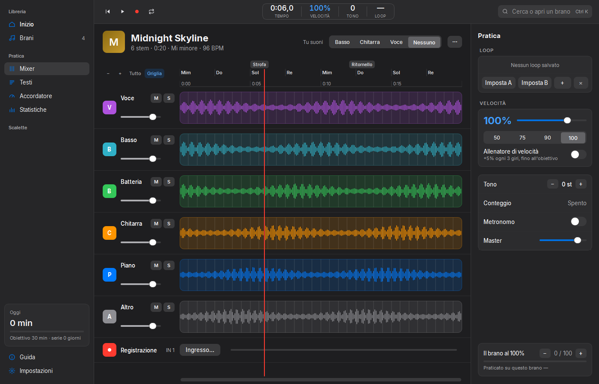
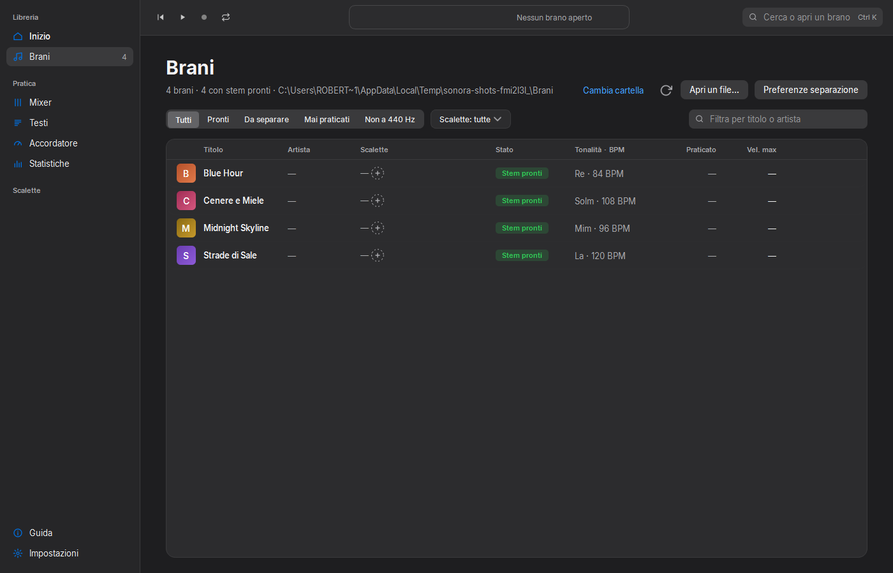
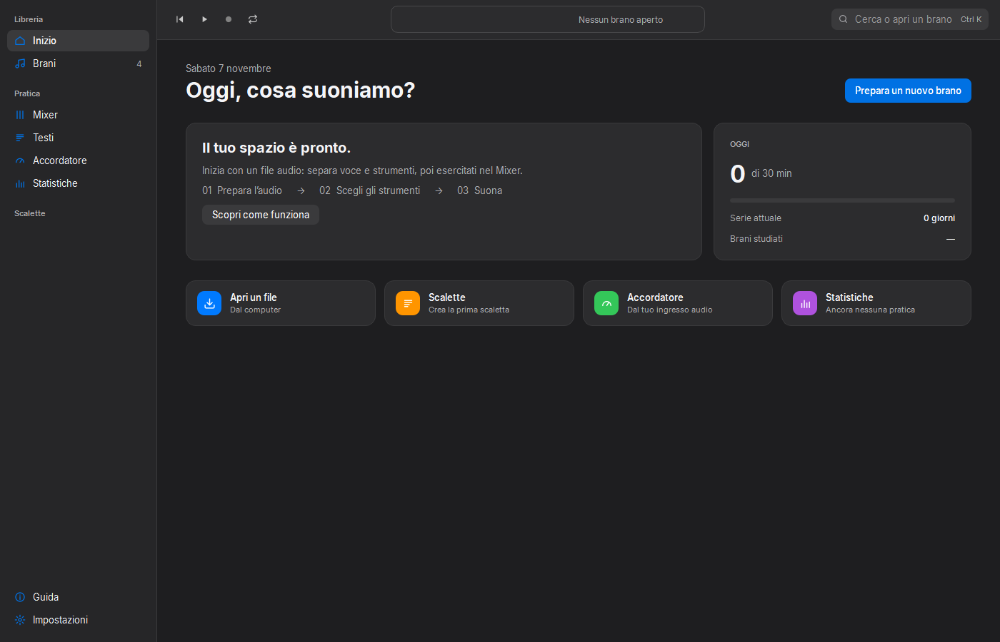

# Sonora

**Italiano** · [English](#english)

  

App desktop per Windows che **separa un brano nei suoi strumenti** e ti fa **esercitare** sopra: mixer di pratica, visualizzatore di testi e accordatore. Tutto in locale, sul tuo PC.

### ⬇️ [Scarica l'ultima versione](https://github.com/RobyPisco/sonora/releases/latest)

Apri l'installer e vai: al primo uso Sonora prepara da sola il motore di separazione.

---

## Cosa fa

**Separazione in stem**
- Carica un file audio che hai già (mp3, wav, flac, m4a, opus) e ottieni tracce separate: **voce, batteria, basso, chitarra, piano, altro**.
- Motori **Demucs** (2 / 4 / 6 stem e 6 HQ) e **Roformer** (voce/strumentale per il karaoke, oppure 6 stem in cascata).
- Accelerazione su **GPU NVIDIA** quando c'è; altrimenti lavora il processore.

**Mixer — lo studio di pratica**
- Volume, mute, solo, pan ed **EQ a 3 bande** per ogni traccia, con forme d'onda colorate per strumento.
- **Velocità dal 40% al 120%** senza alterare l'intonazione e **trasposizione ±6 semitoni**, in tempo reale (Rubberband R3).
- **Tu suoni**: scegli il tuo strumento e, all'apertura di ogni brano, la sua traccia va in mute da sola.
- **Loop A-B** salvabili con nome, **allenatore di velocità** (parte dal 60% e sale del 5% ogni 3 giri fino al tuo obiettivo) e **obiettivo di velocità** per brano e per loop.
- **Analisi**: tonalità, BPM, LUFS, beat, accordi e sezioni, mostrati sul righello; poi metronomo e pre-conteggio.
- **Accorda a 440 Hz**: se il brano è registrato con il LA più alto o più basso, Sonora lo misura e te lo riporta all'accordatura standard.
- **Registrazione**: suoni sopra il brano e riascolti il take, con la latenza compensata.
- **Preset** di mix (karaoke, senza basso, senza batteria…), punti del brano con nome e **scalette** per le prove.
- Il mix si salva da solo per ogni brano: riapri il pezzo e ritrovi tutto com'era.

**Brani, Inizio e Statistiche**
- **Brani**: la tua libreria in tabella, con ricerca, filtri (pronti, da separare, mai praticati, non a 440 Hz), tonalità e BPM già visibili e il pulsante «Separa i mancanti».
- **Inizio**: riprendi esattamente da dove avevi lasciato (stesso punto, stesso loop), con i minuti di oggi, la serie di giorni e i brani da ripassare.
- **Statistiche**: minuti studiati su 7 giorni, 30 giorni o sempre, con l'elenco «Da riprendere».

**Esporta**
- Mix unico, tutti gli stem separati, **basi «senza una traccia»** (NO_VOCE, NO_BASSO…), loop, click e **foglio accordi** in testo, anche trasposti e con la correzione a 440 Hz.

**Testi e accordatore**
- Testi cercati in automatico (database libero LRCLIB), anche **sincronizzati**: la riga corrente si illumina, click su una riga per saltarci.
- Toni di riferimento (A440, corde di chitarra e basso) e **accordatore dal microfono**.

**Aspetto**
- Tema chiaro, scuro o automatico come Windows; sei colori principali; **Modalità palco** ad alto contrasto per suonare con poca luce.
- Dimensione dell'interfaccia dal 100% al 150%, notazione degli accordi italiana (Do Re Mi) o inglese (C D E).

## Requisiti

- Windows 10 o 11 (64 bit).
- Al primo uso Sonora scarica il motore di separazione: **~3 GB**, una volta sola.
- GPU NVIDIA consigliata ma non necessaria.

## Privacy

Tutto il lavoro avviene **sul tuo computer**: i file non vengono caricati da nessuna parte. Sonora esce su internet solo per scaricare il motore al primo uso, cercare i testi e controllare gli aggiornamenti.

## Prezzo

Sonora è **gratuito**, senza funzioni a pagamento e senza scadenze. Se ti è utile puoi [offrire una donazione](https://www.paypal.com/cgi-bin/webscr?cmd=_donations&business=roberto.pisconti%40gmail.com&item_name=Sostieni%20Sonora&currency_code=EUR&amount=10&no_shipping=1): sostiene lo sviluppo.

## Problemi o idee

Scrivi a **roberto.pisconti@gmail.com** — dall'app: Impostazioni → Motore stem → «Esporta diagnostica» crea uno zip da allegare.

---

# Sonora (English)

Windows desktop app that **splits a song into its instruments** and lets you **practice** over them: a practice mixer, a lyrics viewer and a tuner. Everything runs locally on your PC.

### ⬇️ [Download the latest version](https://github.com/RobyPisco/sonora/releases/latest)

Run the installer and you're set: on first use Sonora sets up the separation engine by itself.

## What it does

**Stem separation**
- Load an audio file you already have (mp3, wav, flac, m4a, opus) and get separate tracks: **vocals, drums, bass, guitar, piano, other**.
- **Demucs** (2 / 4 / 6 stems and 6 HQ) and **Roformer** (vocals/instrumental for karaoke, or 6 stems in cascade) engines.
- **NVIDIA GPU** accelerated when available; otherwise the CPU does the work.

**Mixer — the practice studio**
- Volume, mute, solo, pan and a **3-band EQ** per track, with waveforms colored by instrument.
- **Speed from 40% to 120%** without changing pitch and **±6 semitone transpose**, in real time (Rubberband R3).
- **You play**: pick your instrument and its track is muted automatically whenever you open a song.
- Named **A-B loops**, a **speed trainer** (starts at 60% and climbs 5% every 3 passes up to your goal) and a **speed goal** per song and per loop.
- **Analysis**: key, BPM, LUFS, beats, chords and sections, shown on the ruler; then metronome and count-in.
- **Tune to 440 Hz**: if a song was recorded with A sharper or flatter than 440, Sonora measures it and brings it back to standard pitch.
- **Recording**: play over the song and listen back to your take, with latency compensated.
- Mix **presets** (karaoke, no bass, no drums…), named song points and **setlists** for rehearsals.
- The mix saves itself per song: reopen the track and everything is as you left it.

**Songs, Home and Stats**
- **Songs**: your library as a table with search, filters (ready, to separate, never practiced, not at 440 Hz), key and BPM at a glance and a "Separate the missing ones" button.
- **Home**: resume exactly where you left off (same position, same loop), with today's minutes, your streak and songs to review.
- **Stats**: minutes practiced over 7 days, 30 days or all time, with a "To resume" list.

**Export**
- A single mix, all stems separately, **"minus one" backing tracks** (NO_VOCE, NO_BASSO…), loops, click and a text **chord sheet**, also transposed and with the 440 Hz correction.

**Lyrics and tuner**
- Lyrics fetched automatically (the free LRCLIB database), **synced** when available: the current line lights up, click a line to jump there.
- Reference tones (A440, guitar and bass strings) and a **microphone tuner**.

**Look and feel**
- Light, dark or automatic theme like Windows; six accent colors; a high-contrast **Stage mode** for playing in low light.
- Interface size from 100% to 150%, chord notation in Italian (Do Re Mi) or English (C D E).

## Requirements

- Windows 10 or 11 (64-bit).
- On first use Sonora downloads the separation engine: **~3 GB**, once.
- An NVIDIA GPU is recommended but not required.

## Privacy

Everything happens **on your computer**: your files are never uploaded. Sonora only goes online to fetch the engine on first use, look up lyrics and check for updates.

## Price

Sonora is **free**, with no paid features and no expiry. If you find it useful you can [donate](https://www.paypal.com/cgi-bin/webscr?cmd=_donations&business=roberto.pisconti%40gmail.com&item_name=Sostieni%20Sonora&currency_code=EUR&amount=10&no_shipping=1): it supports development.

## Problems or ideas

Write to **roberto.pisconti@gmail.com** — in the app: Settings → Stem engine → "Export diagnostics" creates a zip to attach.
